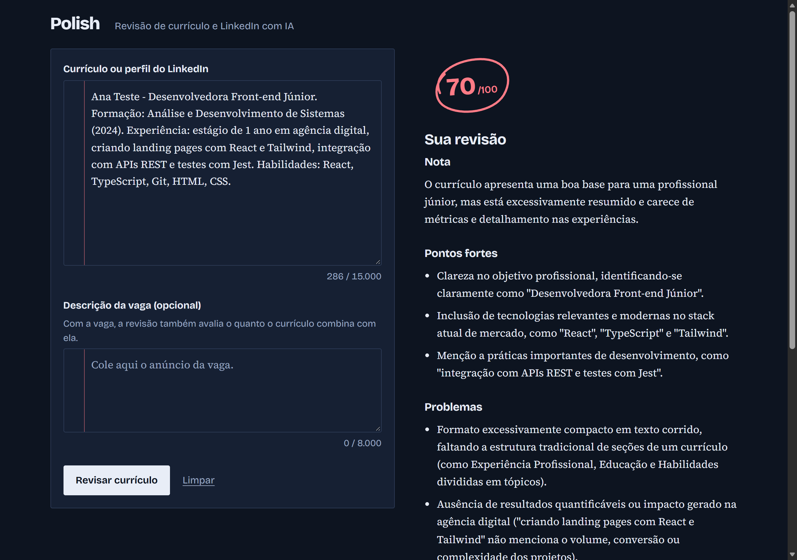

# Polish

Revisor de currículo com IA. Você cola o texto do currículo (e, se quiser, o anúncio da vaga) e recebe uma nota de 0 a 100, os pontos fortes, os problemas e sugestões concretas. A resposta aparece enquanto é escrita, sem tela de carregamento parada.

**Demo:** [polish-inky.vercel.app](https://polish-inky.vercel.app)

[](https://github.com/g4bri3llucas/polish/actions/workflows/ci.yml)



## Como funciona

```
Angular  ──POST /api/review/stream──►  Express  ──SDK──►  Gemini
         ◄──── text/event-stream ────           ◄─stream─
```

O front manda o texto para a API. A API valida, monta o prompt e repassa ao Gemini. Cada pedaço gerado volta para o navegador como um evento SSE, e o Angular vai montando a revisão na tela.

A chave do Gemini fica só no servidor. O navegador nunca fala direto com o modelo.

## Decisões que valem comentar

**SSE lido com `fetch`, não com `EventSource`.** O `EventSource` só faz GET, e a revisão precisa mandar o currículo no corpo de um POST. Por isso o cliente lê o `ReadableStream` da resposta com um parser de SSE próprio (`client/src/app/sse-parser.ts`). A leitura aguenta mensagens e acentos cortados no meio entre um pacote de rede e outro.

**O modelo fica atrás de uma interface.** O back-end depende de `LlmClient`, não do SDK do Gemini. Trocar de provedor é escrever uma classe, e nos testes basta passar uma implementação em memória. Nenhum teste chama a API de verdade.

**O plano gratuito do Gemini oscila.** Com frequência ele responde 503 ("high demand"), às vezes no meio da resposta. O servidor trata isso em duas camadas:

- antes do primeiro pedaço, tenta de novo depois de 1 s e de 3 s;
- se cair no meio, avisa o front com um evento `restart` e gera a revisão do zero, até duas vezes.

Do lado do cliente, o evento `restart` limpa o texto parcial e mostra "Recomeçando a revisão", em vez de juntar duas respostas diferentes.

**Limites na API.**

- Validação com Zod: currículo entre 50 e 15.000 caracteres e vaga até 8.000.
- Corpo de no máximo 100 KB.
- Rate limit de 10 revisões por minuto por IP. Atrás de proxy, o `TRUST_PROXY` diz quantos saltos ignorar para chegar ao IP real.
- Erros saem sempre no formato `{ error: { code, message } }`.

**Estado com signals.** O `ReviewStore` guarda status, texto e erro, e o painel só lê dele. Assim a parte de HTTP não se mistura com a interface.

## Stack

| | |
| --- | --- |
| Front-end | Angular 22, TypeScript, RxJS, signals |
| Back-end | Node.js, Express 5, TypeScript, Zod, express-rate-limit |
| IA | Google Gemini via `@google/genai` |
| Testes | Vitest nos dois lados |
| Infra | Vercel (front e API em projetos separados), GitHub Actions |

## Rodando localmente

Você precisa de Node.js 20 ou mais novo e de uma chave gratuita do Gemini, que pode ser criada no [Google AI Studio](https://aistudio.google.com/apikey).

Primeiro a API:

```bash
cd server
npm install
cp .env.example .env
npm run dev
```

No `.env`, preencha pelo menos `LLM_API_KEY` e `LLM_MODEL` (por exemplo `gemini-3.5-flash-lite`). Ela sobe em `http://localhost:3000`.

Depois, em outro terminal, o front:

```bash
cd client
npm install
npm start
```

O front abre em `http://localhost:4200` e, em desenvolvimento, aponta para a API local. A URL de produção fica em `client/src/environments/environment.ts`.

### Variáveis da API

| Variável | Para quê | Padrão |
| --- | --- | --- |
| `LLM_API_KEY` | Chave do Gemini | obrigatória |
| `LLM_MODEL` | Id do modelo | obrigatória |
| `PORT` | Porta da API | `3000` |
| `CLIENT_ORIGIN` | Origem liberada no CORS | `http://localhost:4200` |
| `TRUST_PROXY` | Quantos proxies ficam na frente da API | `0` |

## Testes

```bash
cd server && npm test
cd client && npm test -- --watch=false
```

A cada push e pull request na `main`, o CI roda os testes e o build dos dois lados, mais o typecheck do servidor.

## Endpoints

| Método | Rota | O que faz |
| --- | --- | --- |
| `GET` | `/api/health` | Health check |
| `POST` | `/api/review` | Revisão completa numa resposta só |
| `POST` | `/api/review/stream` | Revisão em streaming (SSE) |

## Licença

[MIT](LICENSE)

Feito por [Gabriel Lucas](https://www.linkedin.com/in/gabriel-lucas-893a342bb/).
